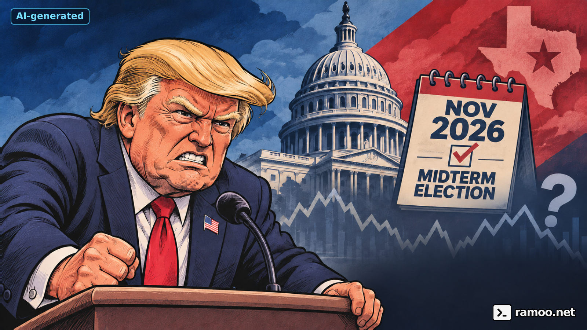
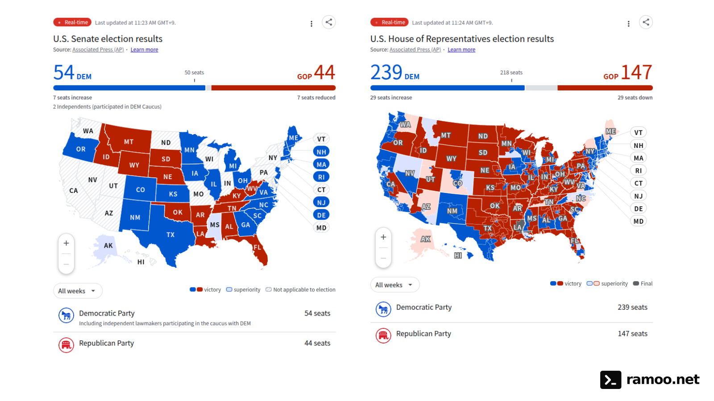

# After the Midterms: Will Checks on Trump Calm Markets—and What About Tesla?

date: 2026-11-05

> An AP election-results capture, Texas outcomes, market scenarios and a separate look at Tesla’s EV business and SpaceX merger discussions.

Will congressional checks on Donald Trump make markets calmer? **They could reduce the risk of abrupt legislative changes, but that is a scenario—not a guarantee of rising stocks or a stable policy environment.** Texas politics and the proposed Tesla–SpaceX combination add a separate set of questions for individual companies.

*News analysis and personal commentary checked November 5, 2026, Korea Standard Time. Election figures below are a captured snapshot, not certified final totals. The scenarios are interpretations, not reported forecasts.*

## The result: Democratic control, with counting still underway

[ABC's AP-based results page](https://www.abc.net.au/news/2026-11-04/us-midterm-election-results-2026/107235570) reports Democratic majorities in both chambers. The image below shows **Senate results on the left and House results on the right**, with AP credited onscreen. The update labels read **11:23 AM for the Senate** and **11:24 AM for the House**, both **GMT+9 (Korea Standard Time)**.

*Onscreen source: Associated Press (AP). Capture filenames indicate November 5, 2026, at 11:24:05 KST for the Senate and 11:24:14 KST for the House. Those capture times are separate from the displayed results-update times. Click to enlarge.*

| Chamber | Democrats / caucus | Republicans | Displayed update time |
| --- | ---: | ---: | --- |
| House | 239 | 147 | 11:24 AM GMT+9 |
| Senate: includes seats not up this year | 54 | 44 | 11:23 AM GMT+9 |

The House count covers all 435 seats. The Senate figures include continuing senators and the two independents caucusing with Democrats: **54 is not the number of Senate seats Democrats won in this election alone.** The two independents are already included in 54 and must not be added again. The table transcribes only the seat counts directly visible in these captures. A race call also does not mean every state's certification process is complete.

The [Texas Secretary of State's count](https://electionresults.sos.state.tx.us/results.html) places James Talarico ahead of Ken Paxton for the U.S. Senate and Gina Hinojosa ahead of Greg Abbott for governor. AP reports victories for both Democrats. Those are changes in different offices with different powers. [AP's Texas coverage](https://apnews.com/article/6e285484736b5116629a3b6e37e1dda5)

The new Congress does not take office the morning after the vote. The Senate explains that Congress normally convenes at noon on January 3 of odd-numbered years unless a law provides otherwise. Markets can price expectations well before those expectations become legislation. [Senate guidance](https://www.senate.gov/general/common/generic/NewCongress_faq.htm)

## Could checks on Trump reduce uncertainty?

My constructive case is that harder negotiations over major tax and spending changes could slow policy swings. Businesses might gain time to plan investment and hiring. This is **my interpretation of a possible transmission mechanism**, not evidence that divided government necessarily produces stronger returns.

There is an opposing mechanism. A budget confrontation can delay decisions without giving companies a clearer long-term framework. The election might replace the risk of rapid legislation with the risk of prolonged bargaining and inconsistent execution.

Tariffs do not disappear automatically when congressional control changes. Congress has delegated certain trade powers to the executive, subject to legal conditions and judicial review. [The Congressional Research Service explains that framework](https://www.congress.gov/crs-product/R48435). A [November 4 Reuters report on corporate reactions](https://www.investing.com/news/stock-market-news/us-democratic-win-unlikely-to-ease-firms-cost-tariff-woes-in-near-term-executives-say-4999169) distinguishes hopes for political stability from the costs businesses still face.

Nor does a rally establish a single cause. AP reported an approximately 1.6% S&P 500 gain on November 4 alongside a sharp fall in oil prices. Election news, energy costs and geopolitical expectations were moving together. [AP's market report](https://apnews.com/article/4d12764c0b3ce38ffde3077712811182)

## Could a path toward ending the war stabilize oil prices?

For the US–Israeli war with Iran, which has direct implications for oil supply, **the election could strengthen incentives for the White House to pursue a diplomatic exit**. A [November 4 Reuters report](https://ca.investing.com/news/stock-market-news/from-iran-to-trade-how-the-us-midterms-impact-the-rest-of-the-world-4929593) describes some Gulf governments viewing the result as an incentive to seek a peace deal. That is an assessment of diplomatic incentives, not confirmation of a ceasefire or the end of the war.

My constructive mechanism is **actual progress toward a ceasefire or agreement → less concern about disrupted shipping and supply → a smaller war-risk premium in oil**. If sustained, that could gradually stabilize prices and ease costs for transport and manufacturing. [Reuters' market commentary that day](https://www.investing.com/news/economy-news/trading-day-oil-tanks-stocks-leap-on-us-midterms-5001616) also connects the oil selloff with mediation hopes. One day's decline, however, does not establish a lasting trend.

I would look beyond announcements to fewer attacks, safer shipping and restored supply. Failed talks or offsetting producer cuts could reverse the decline. Oil can also fall because demand is deteriorating; that would send a different signal about corporate earnings.

## When might the Fed cut interest rates?

The starting point is the Fed's current position. **On October 28, 2026, the FOMC held its target range at 3.75%–4.00%.** Its statement described inflation as elevated, and two dissenters preferred a quarter-point increase. That is not an established rate-cutting backdrop. [Official Federal Reserve statement](https://www.federalreserve.gov/newsevents/pressreleases/monetary20261028a.htm)

Sustained cheaper oil could ease energy inflation and inflation expectations. But I would also watch prices excluding energy, wages and services, employment and consumer demand. If underlying pressure persists, the Fed could keep rates unchanged or raise them despite lower oil.

**My conditional observation window is March–June 2027.** That assumes diplomacy actually improves supply conditions, several inflation reports show the effect and labor-market heat also eases. I would first look for that sequence rather than assume an immediate December 2026 cut. This is **my scenario based on current information**, not Fed guidance, a consensus forecast or a probability calculated from futures prices. If those conditions fail to materialize, the timing assumption should be discarded.

| Path | Conditions needed | What I would watch |
| --- | --- | --- |
| Earlier consideration of cuts | Inflation cools unexpectedly quickly and employment weakens clearly | Whether the policy assessment shifts as early as December 2026 or January 2027 |
| Conditional central scenario | Supply stabilizes, disinflation persists and employment cools gradually | Whether conditions for easing develop in March–June 2027 |
| Extended hold or further hikes | Renewed conflict, an oil rebound or persistent inflation and strong demand | Deferring first-half easing expectations rather than assuming cuts must arrive |

The [official FOMC calendar](https://www.federalreserve.gov/monetarypolicy/fomccalendars.htm) lists **December 8–9, 2026**, followed by **January 26–27, March 16–17, April 27–28 and June 8–9, 2027**. These are US meeting dates, subject to confirmation. A meeting date is not a commitment to cut rates.

Equities can price expected easing before the decision. If cuts instead respond to a sharp downturn, weaker profits could outweigh cheaper financing. I would distinguish the constructive **oil stabilization → disinflation → less interest-rate pressure** scenario from **economic deterioration → earnings downgrades → rate cuts**.

## Three market scenarios to watch

These are my scenarios, not price targets or a statistical return forecast.

| Scenario | Possible effect on equities | Evidence to watch |
| --- | --- | --- |
| Negotiation moderates policy swings | Better planning conditions could reduce the discount investors demand for policy risk | Agreed budgets and trade measures; companies maintaining investment plans |
| Political confrontation persists | Delayed spending or approvals could lead businesses to postpone projects | Failed negotiations, conflicting government actions, weaker earnings guidance |
| Growth and interest rates dominate | Softer demand or expensive financing could outweigh political relief | Earnings revisions, long-term yields, credit spreads and consumer indicators |

A rising index does not imply that every sector benefits. Government-dependent revenue, regulatory exposure and customers' financing costs can pull companies in different directions. I would ask **which part of revenue, margins, capital spending or financing changes**, rather than treating party control as a trading signal.

## Could data-center restrictions affect semiconductor profitability?

**My concern is that tougher scrutiny of new data centers could push back AI-chip orders and revenue.** A Democratic election victory is not itself the implementation of a nationwide construction restriction. Congressional oversight, state incentives and local siting, power and water requirements need separate assessment. A [November 4 Reuters report](https://www.investing.com/news/stock-market-news/ai-data-center-stocks-dip-renewables-surge-after-democrat-sweep-in-us-midterm-elections-4998519) describes regulatory concerns and weakness in data-center shares, while also noting doubts about whether legislation would substantially halt construction.

If building or grid-connection schedules slip, operators could reschedule server purchases. My inference is that deliveries of GPUs, AI accelerators, high-bandwidth memory (HBM) and networking chips could then be delayed. **Demand for computing does not immediately become chip revenue if the installation site and electricity are not ready.** If suppliers have already expanded capacity and customers reduce or cancel orders, inventories, pricing and capacity utilization could transmit that slowdown into weaker profitability.

Delayed revenue is different from destroyed long-term demand. Operators might upgrade existing sites, move investment to other locations or use hardware more efficiently. Supply constraints and contract terms also vary by product, so I would not assume that tighter construction rules reduce every semiconductor company's earnings. Cloud operators and chip suppliers can face different economics: [another Reuters report that day](https://www.investing.com/news/stock-market-news/democrats-midterm-sweep-fuels-750-billion-big-tech-rally-5000648) describes investors anticipating less pressure on some large operators' capital spending if the buildout slows.

My checkpoints are:

- **Policy and construction:** Do campaign promises or hearings become actual permit delays, reduced incentives or postponed projects?
- **Orders and deliveries:** Do customers change AI investment budgets, server deployment schedules or GPU and HBM orders?
- **Profitability:** Do suppliers' revenue guidance, inventories, utilization and gross margins weaken together?

My view is that **political relief for the broader market can coexist with an earnings risk for chip suppliers dependent on new AI infrastructure spending**. The strength of any restrictions—and the size of a resulting earnings impact—remains unverified.

## Texas and Tesla: separate the levels of government

Tesla's [October 21 filing](https://ir.tesla.com/_flysystem/s3/sec/000162828026066738/tsla-20261021-gen.pdf) identifies its Texas incorporation and Austin address. That makes Texas relevant, but a new governor, a new U.S. senator and a different congressional majority are not interchangeable forms of control.

My state-level checklist is factory-related approvals, infrastructure, electricity supply and tax or incentive arrangements. These are **questions to investigate**, not claims that the incoming government has already adopted an adverse Tesla policy. Federal automotive and energy rules require a separate assessment. The Texas result alone cannot establish Tesla's commercial outlook.

The EV business also deserves analysis separate from election headlines. Tesla reported **486,532 vehicle deliveries** and **13.7 GWh of energy-storage deployments** for Q3 2026. Its release cautions against using deliveries alone to judge financial performance. [Tesla Investor Relations, October 2](https://ir.tesla.com/press-release/tesla-third-quarter-2026-production-deliveries-and-deployments)

I would watch selling prices and discounts, automotive margins, inventory and cash flow alongside the next delivery number. More vehicles sold at substantially lower prices can produce a different shareholder outcome. The contribution of energy storage should be measured rather than assumed to offset any weakness elsewhere.

## Tesla–SpaceX: discussions are not a completed deal

[Reuters reported on October 22](https://www.investing.com/news/stock-market-news/spacex-says-tesla-merger-would-need-musks-approval-4967546) that the companies had formed special committees to discuss a combination, which Musk supported. **That is not confirmation of a completed merger or a settled exchange ratio.**

My deal checklist has three parts:

- **Terms:** How are the businesses valued, and how would existing shareholders' ownership change?
- **Economics:** Would cooperation in technology, manufacturing or energy deliver measurable benefits? How would capital requirements be shared?
- **Process:** How are conflicts involving a common executive addressed, and what do committees, disclosures and any required approvals establish?

These are evaluation questions, not a substitute for missing transaction terms. I would not automatically assign SpaceX's growth prospects to Tesla shareholders, or assume that merger discussions solve the EV business's pricing and demand challenges.

## My current view

The prospect of more predictable policymaking is a reasonable constructive scenario. The test is whether it becomes **actual agreements and sustainable corporate earnings**. Diplomacy and steadier oil could ease inflation and financing pressure, but the conditions for Fed cuts still have to materialize. For AI-chip suppliers, construction rules must be traced through orders, deliveries and margins. For Tesla, Texas policy, EV profitability and merger terms remain separate things to verify.

This view can change as counts are certified and the next Congress acts. The article is dated news commentary, not a recommendation to buy or sell a security or a promise of investment returns.

