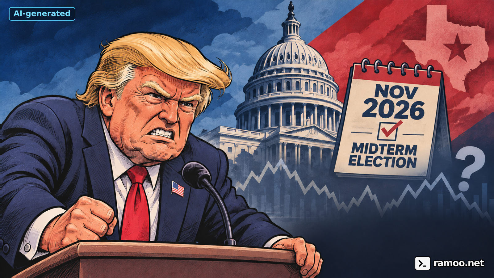
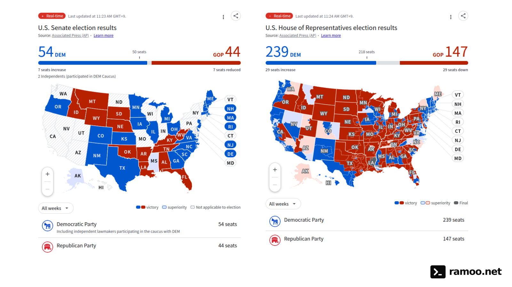

# 미국 중간선거 이후: 트럼프 견제는 증시를 안정시킬까, 텍사스와 테슬라는?

date: 2026-11-05

> 미국 중간선거 AP 집계 화면과 텍사스 결과를 확인하고, 의회의 트럼프 견제·증시 시나리오·테슬라 전기차 사업과 스페이스X 합병 논의를 구분해 살펴봅니다.

트럼프를 견제할 의회가 생기면 시장도 한숨 돌릴 수 있을까? **급격한 입법 변화의 위험이 줄어들 수 있다는 기대는 이해하지만, 그것을 곧바로 주가 상승이나 정책 안정의 보증으로 보기는 어렵다.** 텍사스의 정치 변화와 테슬라·스페이스X 합병 논의까지 겹쳐, 지수 전체와 개별 기업을 나눠 볼 때다.

*2026년 11월 5일 한국 시간에 확인한 개표 집계와 공시를 바탕으로 쓴 뉴스 해설·개인 의견이다. 아래 집계는 캡처 시점의 스냅샷이며 최종 인증 결과가 아니다. 시나리오는 전망이지 확정 사실이 아니다.*

## 선거 결과: 민주당의 양원 다수 확보와 남아 있는 개표

[ABC의 AP 기반 선거 결과 페이지](https://www.abc.net.au/news/2026-11-04/us-midterm-election-results-2026/107235570)는 민주당의 상·하원 다수 확보를 전한다. 아래는 AP를 출처로 표시한 **상원(왼쪽)·하원(오른쪽) 결과 화면**이다. 화면에 표시된 집계 갱신 시각은 상원 **11:23 AM**, 하원 **11:24 AM**이며 모두 **GMT+9(한국 시간)**다.

*출처 표기: Associated Press(AP). 파일명 기준 캡처 시각은 2026년 11월 5일 상원 11:24:05 KST, 하원 11:24:14 KST다. 캡처 시각과 화면의 집계 갱신 시각은 구분했다. 클릭하면 크게 볼 수 있다.*

| 구분 | 민주당·코커스 | 공화당 | 화면 갱신 표시 |
| --- | ---: | ---: | --- |
| 하원 | 239 | 147 | 11:24 AM GMT+9 |
| 상원: 비선거 의석 포함 | 54 | 44 | 11:23 AM GMT+9 |

하원은 전체 435석을 대상으로 집계하고, 상원 숫자는 이번에 선거를 하지 않은 기존 의석과 민주당 코커스에 참여하는 무소속 2명까지 포함한다. **상원 54석을 이번 선거에서만 새로 얻었다는 뜻으로 읽으면 안 된다.** 상원의 민주당 코커스에 참여하는 무소속 2명은 54석에 이미 포함돼 있으므로 별도로 더하지 않는다. 표에는 두 캡처에서 직접 확인되는 의석 수만 옮겼다. 화면의 승자 판정과 주별 최종 인증 절차의 완료도 구분해야 한다.

[텍사스 주정부 집계](https://electionresults.sos.state.tx.us/results.html)에서는 연방 상원의원 선거의 제임스 탈라리코가 켄 팩스턴을, 주지사 선거의 지나 이노호사가 그레그 애벗을 앞선다. AP도 두 민주당 후보의 승리를 보도했다. 이 글에서는 연방 상원 선거와 텍사스 주지사 선거를 별개의 권한 변화로 본다. [AP의 텍사스 보도](https://apnews.com/article/6e285484736b5116629a3b6e37e1dda5)

새 의회의 권한이 개표 다음 날 즉시 시작되는 것은 아니다. 미 상원은 새 의회의 개원일을 원칙적으로 홀수 해 1월 3일 정오로 안내하며 법률로 다른 일정을 정할 수 있다고 설명한다. 선거 직후 시장의 기대와 실제 입법 변화 사이에는 시간이 있다. [미 상원 안내](https://www.senate.gov/general/common/generic/NewCongress_faq.htm)

## 민주당의 견제가 불확실성을 줄여 줄까?

내가 기대하는 효과는 대통령이 모든 정책을 마음대로 바꾸기 어려워지면서 기업이 투자·고용 계획을 세울 시간을 얻는 것이다. 세금·지출을 크게 바꾸는 법안에 협상이 필요해지면 정책의 급커브가 줄 수 있다. 이는 가능한 경로에 대한 **내 해석**이다.

하지만 분점 정부에는 반대 방향의 경로도 있다. 예산 협상이 꼬이거나 대통령과 의회가 서로 책임을 떠넘기면, 기업이 기다려야 할 시간만 길어질 수 있다. 선거가 정책의 불확실성을 없애기보다 **입법 변화의 위험을 협상·집행의 위험으로 바꾸는 것**일 수도 있다.

관세도 의회 선거 한 번으로 자동 철회되지 않는다. 의회가 대통령에게 위임한 통상 권한이 있고 적용 조건과 법원 판단도 따져야 한다. [CRS의 관세 권한 설명](https://www.congress.gov/crs-product/R48435)은 제도적 배경을 제공한다. 현재 기업들의 반응을 취재한 [11월 4일 Reuters 보도](https://www.investing.com/news/stock-market-news/us-democratic-win-unlikely-to-ease-firms-cost-tariff-woes-in-near-term-executives-say-4999169)도 정치적 안정에 대한 기대와 당장의 원가·관세 부담을 구분한다.

선거 다음 날 주가가 올랐다고 인과관계를 하나로 정리하기도 이르다. AP는 11월 4일 S&P 500의 약 1.6% 상승과 함께 유가 급락도 전했다. 선거 결과뿐 아니라 에너지 비용과 지정학적 기대가 동시에 움직인 날이었다. [AP 시장 보도](https://apnews.com/article/4d12764c0b3ce38ffde3077712811182)

## 전쟁이 끝날 가능성이 커지면 유가도 안정될까?

유가와 직접 연결되는 미국·이스라엘과 이란의 전쟁을 보면, **중간선거 이후 백악관이 외교적 출구를 더 적극적으로 찾을 수 있다는 기대**에는 주목할 만하다. [11월 4일 Reuters 보도](https://ca.investing.com/news/stock-market-news/from-iran-to-trade-how-the-us-midterms-impact-the-rest-of-the-world-4929593)는 일부 걸프 국가들이 선거 결과로 평화 협상을 추진할 유인이 커졌다고 본다는 전언을 소개했다. 하지만 이는 관련국의 판단과 기대이지, 휴전 합의나 전쟁 종식이 확인됐다는 의미는 아니다.

내가 보는 안정화 경로는 **실제 휴전·합의 진전 → 원유 수송과 공급 차질 우려 완화 → 유가에 붙은 전쟁 위험 프리미엄 축소**다. 이것이 이어진다면 유가가 점차 안정되고 운송·제조업의 비용 부담도 덜어질 수 있어 보인다. [같은 날 Reuters 시장 해설](https://www.investing.com/news/economy-news/trading-day-oil-tanks-stocks-leap-on-us-midterms-5001616)도 유가 급락과 종전 중재 기대를 함께 다뤘다. 다만 하루의 하락을 지속적인 안정으로 읽지는 않겠다.

그 기대가 유지되려면 협상 발표보다 실제 공격 감소, 운항 안전, 공급 회복을 확인해야 한다. 협상이 깨지거나 산유국이 감산으로 대응하면 유가가 다시 오를 수 있다. 경기 둔화로 수요가 줄어 유가가 내리는 경우도 있어, 유가 하락을 언제나 기업 이익에 좋은 신호로 해석할 수는 없다.

## 그렇다면 연준의 금리 인하는 언제쯤일까?

출발점은 현재 연준의 판단이다. **2026년 10월 28일 FOMC는 기준금리 목표 범위를 3.75~4.00%로 동결**했다. 성명은 물가가 여전히 높다고 평가했고, 반대한 두 위원은 0.25%p 인상을 선호했다. 따라서 지금을 이미 인하가 확정된 국면으로 전제해서는 안 된다. [연준 공식 성명](https://www.federalreserve.gov/newsevents/pressreleases/monetary20261028a.htm)

유가 하락이 지속되면 에너지 물가와 기대인플레이션을 낮추는 데 도움이 될 수 있다. 그러나 에너지를 제외한 물가, 임금·서비스 가격, 고용·소비까지 같은 방향으로 진정되는지 봐야 한다. 유가가 내려도 수요가 강하고 물가 압력이 남아 있으면 연준은 동결을 이어가거나 추가 인상을 선택할 수 있다.

**내 조건부 관찰 구간은 2027년 3~6월이다.** 종전 협상이 실제 공급 안정으로 연결되고, 그 효과가 여러 차례의 물가 지표에 반영되며 고용 과열도 완화된다는 가정에서다. 2026년 12월에 곧바로 인하를 단정하기보다는 이 과정을 먼저 확인하겠다는 뜻이다. 이는 연준의 예고나 시장의 합의 전망, 선물 가격으로 계산한 확률이 아니라 **현재 정보에 기초한 개인적인 시나리오**다. 조건이 충족되지 않으면 이 시점 전망도 폐기해야 한다.

| 경로 | 필요한 조건 | 내가 확인할 시점 |
| --- | --- | --- |
| 인하 논의가 빨라짐 | 물가가 예상보다 빠르게 진정되고 고용도 뚜렷하게 약해짐 | 2026년 12월·2027년 1월 회의부터 판단이 달라지는지 확인 |
| 조건부 중심 시나리오 | 공급 안정과 물가 둔화가 이어지고 고용도 점진적으로 진정됨 | 2027년 3~6월에 인하 여건이 갖춰지는지 관찰 |
| 동결 장기화 또는 추가 인상 | 전쟁 재격화, 유가 재상승, 끈질긴 물가·강한 수요 | 상반기 인하 기대를 미루고 연준의 실제 판단을 따름 |

[연준 공식 일정](https://www.federalreserve.gov/monetarypolicy/fomccalendars.htm)상 다음 회의는 **2026년 12월 8~9일**, 이후 **2027년 1월 26~27일, 3월 16~17일, 4월 27~28일, 6월 8~9일**이다. 날짜는 미국 현지 회의 일정이며 추후 변경될 수 있다. 회의가 예정돼 있다는 사실이 해당 회의의 인하를 뜻하지는 않는다.

주식시장에서는 인하 기대가 실제 결정 전에 가격에 반영될 수 있다. 또 경기 침체 때문에 금리를 내리는 경우에는 자금조달 비용의 개선보다 기업 이익 악화가 더 크게 작용할 수 있다. 나는 **유가 안정 → 물가 둔화 → 금리 부담 완화**라는 긍정적 경로와 **경기 악화 → 실적 하향 → 인하**라는 경로를 구분해서 보겠다.

## 향후 증시: 세 가지 경로를 확인한다

아래 표는 확인된 전망치나 목표주가가 아니라, 선거 이후 내 생각을 점검하기 위한 시나리오다.

| 시나리오 | 주식시장에 전달되는 경로 | 확인할 신호 |
| --- | --- | --- |
| 협상으로 정책 변화가 완만해짐 | 기업의 계획 가능성이 좋아지고, 위험에 대한 할인 폭이 줄어들 여지 | 실제 합의된 예산·통상 조치, 기업의 투자 계획 유지 |
| 정치 충돌이 장기화됨 | 지출·인허가 결정이 늦어지고 기업이 투자나 채용을 미룰 가능성 | 협상 결렬, 행정부·의회의 상충 조치, 실적 전망 하향 |
| 정치보다 경기·금리가 강하게 작용함 | 정책 안정 기대가 있어도 소비 둔화나 자금조달 비용이 이익을 압박 | 실적 가이던스, 장기금리, 신용스프레드, 소비 지표 |

지수가 오르는 장에서도 모든 종목이 같은 이익을 얻지는 않는다. 규제의 방향이 중요한 업종, 정부 예산에 민감한 기업, 소비자가 금리 부담을 크게 느끼는 업종은 서로 다르게 반응할 수 있다. 정당 색깔 하나보다 **매출·마진·투자비·자금조달 중 무엇이 바뀌는지**를 확인하고 싶다. 데이터센터 건립 규제와 AI 반도체의 수익성이 그 차이를 보여 줄 수 있다.

## 데이터센터 규제가 반도체 수익성에도 영향을 줄까?

**내가 우려하는 경로는 데이터센터 건립 심사가 강화되면서 AI 반도체의 주문과 매출이 뒤로 밀리는 것이다.** 다만 민주당의 선거 승리를 전국적인 건립 제한의 시행과 동일하게 보지는 않는다. 연방 의회의 감독, 주정부의 지원 정책, 지역의 입지·전력·용수 조건은 각각 확인해야 한다. [11월 4일 Reuters 보도](https://www.investing.com/news/stock-market-news/ai-data-center-stocks-dip-renewables-surge-after-democrat-sweep-in-us-midterm-elections-4998519)도 감독 강화에 대한 우려와 데이터센터 관련주의 하락을 전하면서, 입법이 건립을 실질적으로 막을 수 있을지에는 신중한 시각을 소개한다.

건설·전력 연결이 늦어지면 운영사는 서버 도입 일정을 조정할 수 있다. 그 경우 GPU·AI 가속기, HBM 같은 고대역폭 메모리, 네트워크 반도체의 납품이 지연될 수 있다는 것이 내 해석이다. **설치할 공간과 전력이 준비되지 않으면 칩 수요가 있어도 주문이 곧바로 매출이 되지는 않는다.** 이미 공급망이 생산능력을 늘려 둔 상태에서 주문까지 줄거나 취소된다면 재고, 판매가격, 가동률을 통해 수익성이 압박받는 시나리오도 생각할 수 있다.

하지만 매출 시점이 미뤄지는 것과 장기 수요가 사라지는 것은 다르다. 기존 시설에 장비를 더 넣거나 다른 지역으로 투자를 옮길 수 있고, 효율 개선이 신규 증설 일부를 대체할 수도 있다. 제품별 공급 부족 정도와 계약 조건도 달라 **데이터센터 규제 강화 → 모든 반도체 기업의 이익 감소**로 단순화하지는 않겠다. 특히 데이터센터를 소유한 클라우드 기업과 그곳에 칩을 판매하는 기업의 이해관계는 다르다. 같은 날 [Reuters의 빅테크 보도](https://www.investing.com/news/stock-market-news/democrats-midterm-sweep-fuels-750-billion-big-tech-rally-5000648)는 증설 속도 둔화가 일부 대형 사업자의 투자 지출 부담을 줄일 수 있다는 시장 해석도 전했다.

내가 확인할 신호는 다음과 같다.

- **정책과 착공:** 공약·청문회 수준인지, 실제 인허가 지연·지원 축소·착공 보류로 이어지는지.
- **주문과 납품:** 고객사의 AI 투자 계획, 서버 도입 일정, GPU·HBM 주문의 연기 또는 취소가 나타나는지.
- **수익성:** 반도체 기업의 매출 가이던스·재고·가동률·매출총이익률이 함께 약해지는지.

그래서 내 관점은 **정치적 안정 기대가 지수 전체에 긍정적이어도, 신규 AI 인프라 투자에 의존하는 반도체 기업에는 별도의 이익 위험이 생길 수 있다**는 것이다. 아직 확인되지 않은 규제의 강도나 이익 감소율을 숫자로 단정할 단계는 아니다.

## 텍사스가 바뀌면 테슬라도 달라질까?

테슬라의 10월 21일 [공시](https://ir.tesla.com/_flysystem/s3/sec/000162828026066738/tsla-20261021-gen.pdf)에는 텍사스 법인과 오스틴 주소가 기재돼 있다. 그러나 텍사스 주지사가 바뀌는 것, 텍사스의 연방 상원의원이 바뀌는 것, 워싱턴의 의회 다수가 바뀌는 것은 같은 사건이 아니다.

내가 볼 항목은 주·지방정부의 공장 관련 인허가와 기반시설, 전력 공급, 세금·지원 조건이다. 이는 **앞으로 확인할 항목**이며 새 주정부가 이미 테슬라에 불리한 조치를 확정했다는 뜻은 아니다. 연방 차원의 자동차·에너지 정책과 감독은 별도로 봐야 한다. 텍사스의 정치 변화만으로 테슬라의 사업 전망을 단정할 수 없다.

전기차 수요도 정치 뉴스와 분리해 확인할 필요가 있다. 테슬라는 2026년 3분기 인도량 **486,532대**, 에너지저장장치 배치량 **13.7GWh**를 발표했다. 회사 스스로도 인도량만으로 분기 재무 성과를 판단하지 말라고 설명한다. [Tesla IR · 10월 2일](https://ir.tesla.com/press-release/tesla-third-quarter-2026-production-deliveries-and-deployments)

나는 다음 분기의 판매량뿐 아니라 판매가격과 할인, 자동차 마진, 재고, 현금흐름을 함께 보겠다. 전기차 수요가 늘어도 가격을 더 많이 내려야 했다면 주주가 얻는 이익은 다를 수 있다. 에너지저장 사업의 성장이 자동차 사업의 약화를 얼마나 보완하는지도 같은 질문이다.

## 스페이스X 합병: 논의는 사실, 조건과 완료는 다른 문제

[10월 22일 Reuters 보도](https://www.investing.com/news/stock-market-news/spacex-says-tesla-merger-would-need-musks-approval-4967546)에 따르면 양사는 합병을 논의할 특별위원회를 구성했고 머스크도 조합에 긍정적인 뜻을 밝혔다. **이는 테슬라·스페이스X 합병이 이미 완료됐거나 교환비율이 확정됐다는 의미가 아니다.**

내가 합병 기사를 볼 때 우선 확인할 것은 세 가지다.

- **거래 조건:** 각 회사의 가치를 얼마로 보고 기존 주주의 몫이 어떻게 달라지는가.
- **사업과 자금의 연결:** 기술·생산·에너지 협력이 실제 비용 절감이나 매출로 이어지는가. 다른 사업의 투자 부담을 대신 떠안는 구조는 아닌가.
- **절차와 이해상충:** 공통 경영자가 있는 거래에서 위원회의 판단, 주주에 대한 설명, 필요한 승인과 공시가 어떻게 진행되는가.

이 항목들은 아직 확인되지 않은 거래 조건을 대신하는 평가 기준이다. 우주 사업의 성장 기대를 테슬라 주주가 그대로 갖게 된다고 미리 계산하거나, 합병 논의만으로 전기차 판매 문제가 해결된다고 보지는 않는다.

## 지금의 관점

민주당의 견제가 기업에 좀 더 예측 가능한 환경을 줄 수 있다는 기대에는 공감한다. 다만 내 관심은 선거 승리 자체보다 **그 기대가 실제 예산 합의·통상 조치·기업 이익으로 이어지는가**에 있다. 종전 협상과 유가 안정은 물가·금리 부담을 낮출 수 있는 경로지만, 연준이 인하할 여건이 실제로 갖춰지는지까지 확인해야 한다. AI 반도체는 데이터센터 규제가 실제 주문·납품·이익에 미치는 영향을, 테슬라는 텍사스의 정책·전기차 수익성·합병 조건을 따로 확인해야 한다.

선거 집계가 확정되고 새 의회의 행동이 드러나면 이 가정도 바뀔 수 있다. 이 글은 확인 시점의 뉴스 해설이며 특정 종목의 매수·매도 판단이나 수익률을 보장하지 않는다.

